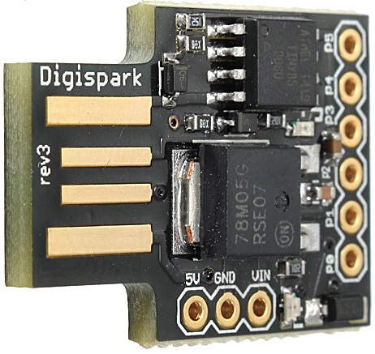

# Mouse Jiggler (with Digispark ATTiny85)
Simple mouse jiggler created using a Digispark ATTiny85:  
  
By default, simply moves the mouse 1 pixel, in sequence, "up", "down", "left" and "right".  
You may need an additional USB "male/female" connector, between the device and your Digispark, to prevent false contacts.

## Setup
1. Open Arduino IDE: go to **File** -> **Preferences** -> set "**Additional Boards Manager URLs**" to "http://drazzy.com/package_drazzy.com_index.json" (the original Digistump package is deprecated)
2. Go to **Tools** -> **Board** -> **Boards Manager...** -> search and install "**ATTinyCore**"
3. Install the DigiMouse library from "https://github.com/LucaReggiannini/digimouse-library" (ATTinyCore does not include it)
4. Go to **Tools** -> **Board** -> select "**ATtiny85 (Micronucleus / DigiSpark)**" and set **Clock** to **16.5 MHz** (other clocks either fail to compile or make USB unreliable)
5. Click **Upload** and plug in the Digispark when prompted

## Notes for my Arch installation
1. Add a _udev rule_ for the Micronucleus bootloader:

```
echo 'SUBSYSTEMS=="usb", ATTRS{idVendor}=="16d0", ATTRS{idProduct}=="0753", MODE:="0666"' | sudo tee /etc/udev/rules.d/49-micronucleus.rules
sudo udevadm control --reload-rules
```

2. If upload fails because the tool does not recognize the bootloader version, replace the executable with the latest Micronucleus release from "https://github.com/micronucleus/micronucleus/releases" (it lives in **$HOME/.arduino15/packages/ATTinyCore/tools/micronucleus/&lt;version&gt;**)

## Notes for my Windows installation
1. Install the **libusb-win32** driver for the Micronucleus bootloader with [Zadig](https://zadig.akeo.ie): **Device** -> **Create New Device**, USB ID **16D0** / **0753**, driver **libusb-win32**, **Install Driver** (creating it manually avoids having to catch the bootloader during its 5-second window)
2. If upload fails with `exit status 0xc0000135`, Micronucleus cannot find `libusb0.dll`. Zadig extracts it into **C:\Users\&lt;user&gt;\usb_driver** (one subfolder per architecture): copy the one matching the architecture of `micronucleus.exe` next to it, renamed `libusb0.dll`. Micronucleus should be in **%LOCALAPPDATA%\Arduino15\packages\ATTinyCore\tools\micronucleus\&lt;version&gt;**. Error `0xc000007b` means wrong architecture: try the other one. Updating ATTinyCore may replace that folder, so the DLL may need to be copied again.
3. If the cursor does not seem to move, disable **Enhance pointer precision** (Mouse settings -> Pointer Options): it can swallow 1-pixel movements. The PC is kept awake anyway.
